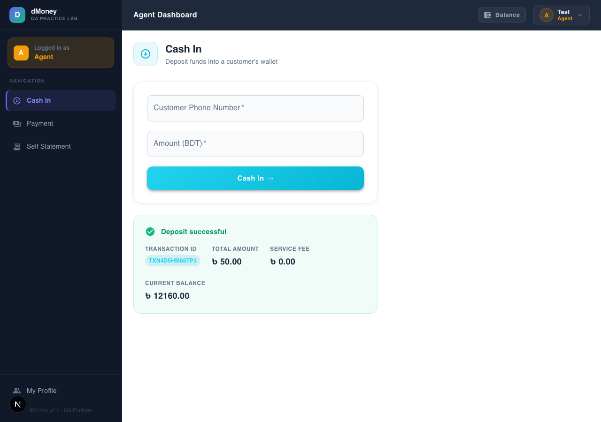
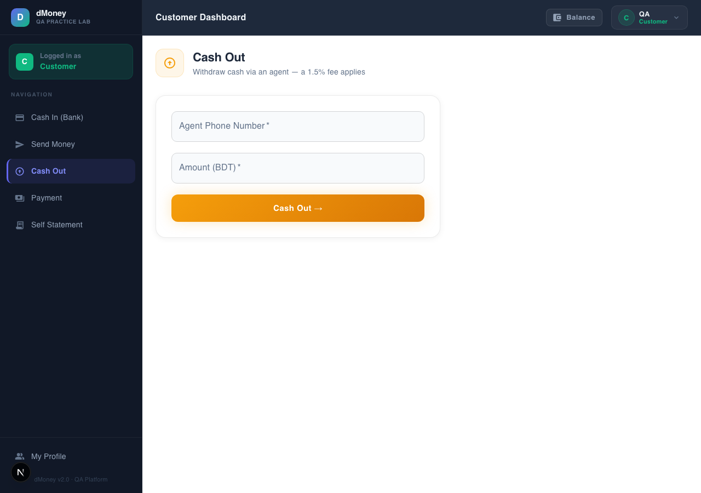
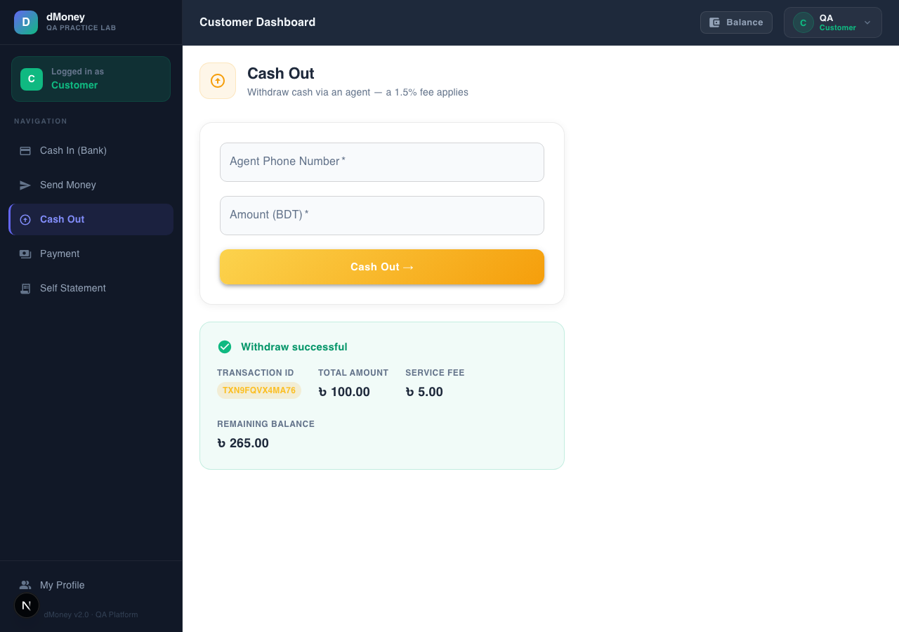
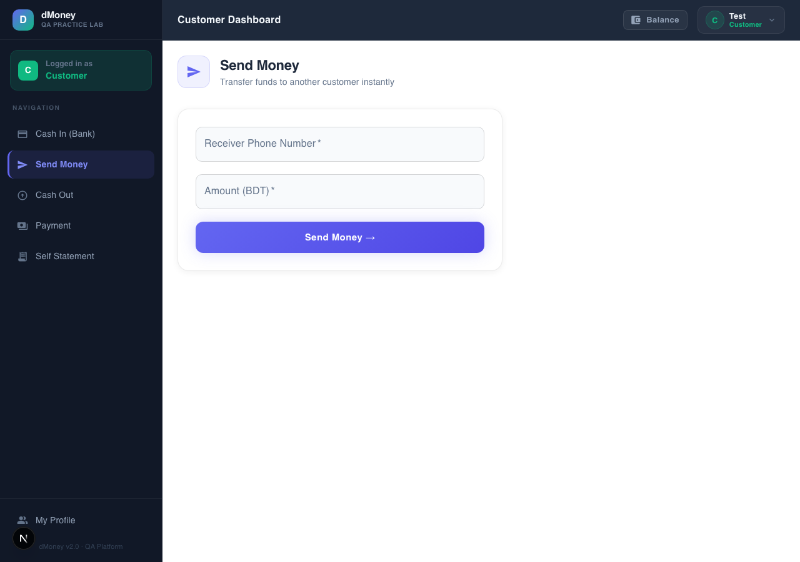
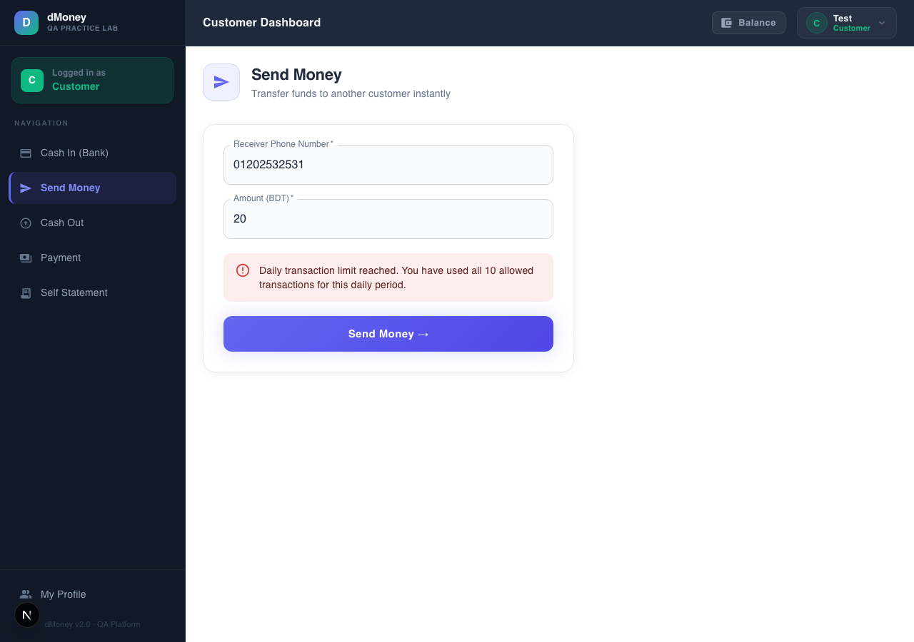

# dMoney Bug Report

> **Note on evidence hosting**: The source prompt asked for screenshots to be uploaded to Google Drive with shareable links. This environment has no authorized Google Drive/Docs connection (Google Drive requires an OAuth flow that can't be completed in this non-interactive session), so screenshots were captured locally instead and are embedded/linked directly from `test-documets/screenshots/` in this repo. For API-only defects that have no corresponding UI screen (raw backend endpoints), the "Evidence" section contains the actual HTTP request/response and matching database query output rather than a screenshot, since no GUI exists to capture for those.

## 1. Document Information

| Field | Value |
|---|---|
| Project Name | DMoney — Mobile Financial Service (MFS) Platform |
| Application Name | dmoney-transaction-api (backend) + dmoney-web-react (frontend) |
| Tester | Claude (AI QA Agent), on behalf of Nowshad |
| Test Date | 2026-07-28 |
| Test Environment | Local dev — API `http://localhost:4000`, Frontend (Next.js) `http://localhost:3000`, MySQL `Nowshad` on localhost |
| Build/Version | Not tagged in repo (no `version` in `package.json`); commit/working-tree state as of test date |

## 2. Test Scope

- Deposit (Cash-in) — Agent → Customer flow via the `agent/cash-in` UI page and `POST /transaction/deposit`
- Withdraw (Cash-out) — Customer → Agent flow via the `customer/cash-out` UI page and `POST /transaction/withdraw`
- Limit Management — the `TransactionLimits`-driven daily/monthly caps enforced by `services/limitChecker.js`, and the read-side endpoints (`GET /transaction/limit/:account`, `GET /transaction/balance/:account`, `GET /transaction/statement/:account`) that expose limit/balance data. **Note**: there is no dedicated "Limit Management" page anywhere in the frontend (confirmed by searching `src/app` and `src/components` for any admin screen that lists/edits limits) — this module was tested entirely at the API/database level, with one UI screenshot showing how a limit rejection actually surfaces to a customer.

## 3. Testing Approach

This was a hybrid manual/exploratory pass combining source review, live UI automation, and direct database verification — not black-box guessing:

1. Read the actual executing code for Deposit (`controllers/transactions/deposit.controller.js`), Withdraw (`withdraw.controller.js`), and the limit system (`services/limitChecker.js`, `controllers/transactions/transactionDetails.controller.js`) to know exactly what should happen before testing whether it does.
2. Drove the **real frontend** (Next.js app on port 3000) with Playwright (Chromium) — logging in through the actual OTP flow (OTP read from the `Users.otp` DB column, since the server persists it regardless of email delivery), then exercising the Cash In and Cash Out screens as a real user would, capturing screenshots at each step.
3. Cross-checked every UI result against the underlying `Transactions` table in MySQL to confirm the ledger actually matches what the screen claims.
4. Ran targeted API-level tests (`curl`) for scenarios that have no UI (the legacy limit endpoint, ownership/IDOR checks, SQL injection probing, and a concurrency race test for duplicate-transaction prevention).
5. Every bug below was reproduced at least once with real evidence (screenshot, raw JSON, or SQL query output) captured in this session — nothing here is inferred from documentation alone. Two areas were explicitly tested and found to be **working correctly** (not bugs): the withdraw endpoint's row-locking prevented a double-spend under concurrent requests, and the Cash Out button's `disabled` state prevented a rapid double-click from firing two withdraw requests. These are called out in Section 6 so the report isn't one-sided.

## 4. Bug Summary

| Bug ID | Title | Module | Severity | Priority | Status |
|---|---|---|---|---|---|
| BUG-001 | Deposit confirmation always shows "Service Fee: ৳0.00" regardless of actual commission charged | Deposit | Low | P3 | Confirmed |
| BUG-002 | Cash Out page subtitle claims "a 1.5% fee applies" but the actual fee shown after a real withdrawal contradicts it on the same screen | Withdraw | Medium | P2 | Confirmed |
| BUG-003 | Deposit ledger does not balance — Agent commission is credited without any matching debit (money minted from nothing) | Deposit | Critical | P1 | Confirmed |
| BUG-004 | Withdraw ledger does not balance — same root cause as BUG-003 | Withdraw | Critical | P1 | Confirmed |
| BUG-005 | SQL Injection in the balance-lookup query used by both Deposit's and Withdraw's "Current/Remaining Balance" display | Deposit / Withdraw / Limit Management | Critical | P1 | Confirmed |
| BUG-006 | Broken access control (IDOR) — any authenticated user can read any other account's balance, statement, or limit info | Limit Management | High | P1 | Confirmed |
| BUG-007 | `GET /transaction/limit/:account` returns a hardcoded, legacy limit figure completely disconnected from the real daily/monthly limit system | Limit Management | High | P2 | Confirmed |
| BUG-008 | Agent and Merchant roles have zero daily/monthly transaction limits — only Customer is metered | Limit Management | Medium | P3 | Confirmed |
| BUG-009 | No proactive limit visibility anywhere in the UI — customers only learn they've hit their daily/monthly cap after a transaction is rejected | Limit Management | Low | P3 | Confirmed |

## 5. Detailed Bug Reports

---

### BUG-001 – Deposit confirmation always shows "Service Fee: ৳0.00" regardless of actual commission charged

**Module:** Deposit (Cash In)
**Severity:** Low
**Priority:** P3
**Environment:** Local dev, `agent/cash-in` page, Chromium (Playwright), Agent account `salmansrabon+agent@gmail.com`
**Preconditions:** Logged in as an active Agent; target Customer account (`01686606902`) is active.

**Steps to Reproduce:**
1. Log in as Agent `salmansrabon+agent@gmail.com`.
2. Navigate to **Cash In**.
3. Enter Customer Phone Number `01686606902`, Amount `50`.
4. Click **Cash In →**.

**Expected Result:** The confirmation panel's "Service Fee" field reflects whatever fee/commission was actually part of this transaction (the API response includes `"commission": 1.25` for this exact request).

**Actual Result:** The confirmation panel always shows **"Service Fee: ৳0.00"**, no matter the amount or the commission actually returned by the API. Verified in `src/app/agent/cash-in/page.tsx` line 175 — the value is a hardcoded literal `৳ 0.00`, never bound to `res.data.commission`.

**Frequency:** Always
**Reproducibility:** 100% (every Agent→Customer deposit)

**Evidence:**


Matching API response for the same request: `{"message":"Deposit successful","trnxId":"TXN9NLCOZO8J8","commission":1.25,"currentBalance":12719.5}` — the real commission (1.25) is available but never displayed.

**Root Cause:** `src/app/agent/cash-in/page.tsx` renders a static `৳ 0.00` for the "Service Fee" label instead of reading `res.data.commission`.

**Suggested Fix:** Store `res.data.commission` in state (mirroring how `customer/cash-out/page.tsx` already does it correctly for `res.data.fee`) and render that value instead of the hardcoded literal.

---

### BUG-002 – Cash Out page subtitle claims "a 1.5% fee applies" but contradicts the actual fee shown on the same screen

**Module:** Withdraw (Cash Out)
**Severity:** Medium
**Priority:** P2
**Environment:** Local dev, `customer/cash-out` page, Chromium (Playwright), fresh Customer account
**Preconditions:** Logged in as an active Customer with sufficient balance; target Agent account is active.

**Steps to Reproduce:**
1. Log in as a Customer.
2. Navigate to **Cash Out** and note the page subtitle: *"Withdraw cash via an agent — a 1.5% fee applies."*
3. Enter Agent Phone Number `01686606901`, Amount `100`.
4. Click **Cash Out →**.
5. Compare the subtitle's claimed rate against the "Service Fee" figure shown in the result panel.

**Expected Result:** If the UI advertises a 1.5% fee, a ৳100 withdrawal should show a ৳1.50 fee (or, if the real backend rate differs, the UI copy should match the backend's actual rate/floor).

**Actual Result:** The result panel shows **"Service Fee: ৳5.00"** for the same ৳100 withdrawal — 5%, not 1.5%, visible on the same screen as the "1.5% fee applies" claim. The real backend rule (confirmed in `sequelizeModel/Commission.js` / DB `Commissions` table) is **1% of amount, floored at a 5 tk minimum** — the 1.5% figure in the UI copy doesn't match either the nominal rate (1%) or the effective rate at this amount (5%).

**Frequency:** Always (the copy is a static string; the fee mismatch appears on every withdrawal below ~500 tk, where the 5 tk floor dominates the true 1% rate)
**Reproducibility:** 100%

**Evidence:**



**Root Cause:** `src/app/customer/cash-out/page.tsx` line 115 hardcodes the descriptive copy `"a 1.5% fee applies"` as a string literal, independent of the actual DB-driven commission config that the same page correctly fetches and displays after submission.

**Suggested Fix:** Either fetch the live rate/floor from the Commission config and interpolate it into the subtitle, or remove the specific percentage claim from static copy entirely (e.g. "a service fee applies — see below").

---

### BUG-003 – Deposit ledger does not balance: Agent commission is credited without any matching debit

**Module:** Deposit
**Severity:** Critical
**Priority:** P1
**Environment:** Local dev API, `POST /transaction/deposit`, direct MySQL verification
**Preconditions:** Active Agent account, active Customer account, Agent has sufficient balance.

**Steps to Reproduce:**
1. As Agent `01686606901`, call `POST /transaction/deposit` with `{"from_account":"01686606901","to_account":"01686606902","amount":50}`.
2. Note the returned `trnxId`.
3. Query `SELECT account, debit, credit FROM transactions WHERE trnxId='<trnxId>'`.

**Expected Result:** Total `debit` across all rows for the `trnxId` should equal total `credit` (a balanced double-entry ledger), per the project's own documented design principle that "every financial operation must write matched, balanced ledger rows."

**Actual Result:** For a 50 tk deposit (2.5% agent commission = 1.25 tk):
```
account       debit   credit
01686606901   50      1.25      <- Agent: debited 50, credited its own commission
01686606902    0      50        <- Customer: credited 50
```
Total debit = 50, total credit = 51.25. The 1.25 tk commission is credited to the Agent without being debited from SYSTEM, the customer, or anyone else — **money is created on every single deposit**.

**Frequency:** Always
**Reproducibility:** 100% — reproduced on a live, fresh transaction (`TXN9NLCOZO8J8`), not just historical data.

**Evidence:**
```
$ curl -X POST http://localhost:4000/transaction/deposit ... -d '{"from_account":"01686606901","to_account":"01686606902","amount":50}'
{"message":"Deposit successful","trnxId":"TXN9NLCOZO8J8","commission":1.25,"currentBalance":12719.5}

$ mysql ... -e "SELECT trnxId, SUM(debit), SUM(credit) FROM transactions WHERE trnxId='TXN9NLCOZO8J8' GROUP BY trnxId"
trnxId          SUM(debit)  SUM(credit)
TXN9NLCOZO8J8   50          51.25
```

**Root Cause:** `controllers/transactions/deposit.controller.js` (Agent→Customer flow) writes `debitTrnx = { account: from_account, debit: amt, credit: commission }` and `creditTrnx = { account: to_account, credit: amt }` — the commission is added as a credit on the Agent's own row with no corresponding debit anywhere else.

**Suggested Fix:** Fund the commission from SYSTEM: add a third ledger row debiting SYSTEM for the commission amount (matching the pattern already correctly used in the SendMoney and Payment controllers), so total debits equal total credits for every `trnxId`.

---

### BUG-004 – Withdraw ledger does not balance: Agent commission is credited without any matching debit

**Module:** Withdraw
**Severity:** Critical
**Priority:** P1
**Environment:** Local dev API, `POST /transaction/withdraw`, direct MySQL verification
**Preconditions:** Active Customer with sufficient balance, active Agent.

**Steps to Reproduce:**
1. As Customer `01686606902`, call `POST /transaction/withdraw` with `{"from_account":"01686606902","to_account":"01686606901","amount":100}`.
2. Query the resulting `trnxId`'s rows in `Transactions`.

**Expected Result:** Balanced ledger (total debit = total credit) for the transaction.

**Actual Result:**
```
account       debit   credit   description
01686606902   105     0        Withdraw            (100 amount + 5 fee)
01686606901     0     102.5    Withdraw            (100 amount + 2.5 commission)
SYSTEM           0     5       Withdraw Service Charge
```
Total debit = 105, total credit = 107.5. The 2.5 tk agent commission is minted from nothing — identical root cause to BUG-003.

**Frequency:** Always
**Reproducibility:** 100% — reproduced live (`trnxId TXN0Q13BD7MBI`).

**Evidence:**
```
$ curl -X POST http://localhost:4000/transaction/withdraw ... -d '{"from_account":"01686606902","to_account":"01686606901","amount":100}'
{"message":"Withdraw successful","trnxId":"TXN0Q13BD7MBI","fee":5,"currentBalance":8865.5}

$ mysql ... -e "SELECT * FROM transactions WHERE trnxId='TXN0Q13BD7MBI'"
id   account       debit  credit  description
126  01686606902   105    0       Withdraw
127  01686606901   0      102.5   Withdraw
128  SYSTEM        0      5       Withdraw Service Charge
```

**Root Cause:** `controllers/transactions/withdraw.controller.js` writes the Agent's credit as `amt + commission` with no offsetting debit for the commission portion.

**Suggested Fix:** Same as BUG-003 — debit SYSTEM for the commission amount instead of creating it unbacked.

---

### BUG-005 – SQL Injection in the balance-lookup query (affects Deposit's and Withdraw's balance displays)

**Module:** Deposit / Withdraw / Limit Management (shared backend service)
**Severity:** Critical
**Priority:** P1
**Environment:** Local dev API
**Preconditions:** Public registration is open (no auth required); attacker needs any valid JWT (even their own, freshly self-registered).

**Steps to Reproduce:**
1. Register a new Customer via the public `POST /user/register` endpoint with `phone_number` set to the 11-character string `zz'OR'1'='1` (registration only validates `phone_number` length, not character format — confirmed via `Joi.string().min(11).max(11)` with no pattern).
2. Using **any** valid JWT (does not need to belong to the account just created), call `GET /transaction/balance/zz'OR'1'='1` (URL-encoded).
3. Compare the returned balance against `SELECT SUM(credit)-SUM(debit) FROM transactions` (the whole ledger's grand total).

**Expected Result:** A brand-new account with zero transactions should return a balance of `0`, or a 404 if account matching failed.

**Actual Result:** The endpoint returned **10000362.75** — which exactly equals the ledger-wide grand total at that moment — proving the injected `OR '1'='1'` clause bypassed the intended per-account `WHERE` filter and aggregated across the entire `Transactions` table.

**Frequency:** Always
**Reproducibility:** 100%, fully self-contained (attacker needs no special privileges — public registration + any authenticated session).

**Evidence:**
```
$ curl -X POST http://localhost:4000/user/register -d '{"name":"QA SQLi POC2","email":"qa.sqli.poc2@gmail.com","password":"1234","phone_number":"zz'\''OR'\''1'\''='\''1","nid":"1234567","role":"Customer"}'
{"message":"Registration successful...","user":{"id":39,...,"phone_number":"zz'OR'1'='1",...}}

$ curl -G "http://localhost:4000/transaction/balance/zz%27OR%271%27%3D%271" -H "Authorization: Bearer <any valid JWT>" -H "X-AUTH-SECRET-KEY: ROADTOSDET"
{"message":"User balance","balance":10000362.75}

$ mysql -e "SELECT SUM(credit)-SUM(debit) AS grand_total FROM transactions;"
grand_total
10000362.75          <- exact match, confirming full-table injection
```
No screenshot applies — this is a raw API/database-level defect with no corresponding UI screen exercising attacker-controlled account identifiers.

**Root Cause:** `services/getBalance.js` builds its SQL via raw string concatenation: `"...WHERE t.\`account\`='" + account + "'"`. Combined with `phone_number` having no format validation at registration, this is directly exploitable.

**Suggested Fix:** Use parameterized queries (`sequelize.query(sql, { replacements: [account] })`), matching the safe pattern already used elsewhere in the same codebase (e.g. the `FOR UPDATE` balance locks inside the transaction controllers). Additionally, restrict `phone_number` to digits only at registration.

---

### BUG-006 – Broken access control (IDOR): any authenticated user can read any other account's balance, statement, or limit

**Module:** Limit Management (and shared by Deposit/Withdraw balance checks)
**Severity:** High
**Priority:** P1
**Environment:** Local dev API
**Preconditions:** Any valid JWT + the shared partner key (`X-AUTH-SECRET-KEY`) — no elevated role required.

**Steps to Reproduce:**
1. Log in as any Customer, obtain a JWT.
2. Call `GET /transaction/balance/<any other account's phone number>` — e.g. the Admin account `01686606909`.
3. Call `GET /transaction/limit/<any other account>` similarly.

**Expected Result:** 403 Forbidden, since the requested account does not belong to the caller.

**Actual Result:**
```
$ curl http://localhost:4000/transaction/balance/01686606909 -H "Authorization: Bearer <customer JWT>" -H "X-AUTH-SECRET-KEY: ROADTOSDET"
{"message":"User balance","balance":-5000}

$ curl http://localhost:4000/transaction/limit/01686606909 -H "Authorization: Bearer <customer JWT>" -H "X-AUTH-SECRET-KEY: ROADTOSDET"
{"message":"User limit","limit":10000}
```
The Customer's token successfully retrieved the **Admin** account's balance and limit info. The same is true for `GET /transaction/statement/:account` (retrieves another user's full transaction history).

**Frequency:** Always
**Reproducibility:** 100%

**Evidence:** Raw request/response above; no UI screen exposes this attacker-controlled path (the frontend only ever calls these endpoints for the logged-in user's own `phoneNumber` from `localStorage`), so there is no corresponding screenshot — the vulnerability is only reachable by calling the API directly, bypassing the UI.

**Root Cause:** `controllers/transactions/transactionDetails.controller.js` — `getBalanceByAccount`, `getStatementByAccount`, and `getTransactionLimitByAccount` all check only that the requested account exists, never that it matches `req.user.identifier`.

**Suggested Fix:** Add an ownership check (`req.user.identifier` must resolve to the same account as `:account`), or restrict these reads to Admin + self.

---

### BUG-007 – `GET /transaction/limit/:account` returns a hardcoded, legacy figure disconnected from the real limit system

**Module:** Limit Management
**Severity:** High
**Priority:** P2
**Environment:** Local dev API
**Preconditions:** Any authenticated account.

**Steps to Reproduce:**
1. Call `GET /transaction/limit/01777000111` for a Customer account.
2. Compare the returned figure against the account's actual configured daily/monthly limits in the `TransactionLimits` table (5,000/day, 50,000/month) and against `services/limitChecker.js`, which is what actually gates transactions.

**Expected Result:** The endpoint should reflect the same limit logic that `checkCustomerLimits()` enforces (daily/monthly amount + count caps).

**Actual Result:** `{"message":"User limit","limit":9915}` — this number comes from an entirely different, legacy formula: `10000 - (SUM(credit) WHERE description='Deposit') + (SUM(debit) WHERE description='Withdraw')`, hardcoded to a base of `10000`. It has no relationship whatsoever to the 5,000/day or 50,000/month figures actually enforced elsewhere, and is not called anywhere in the frontend (confirmed via a full-repo search — the frontend never references this endpoint), meaning it's dead, misleading code that any direct API consumer (e.g. a partner integration) would reasonably rely on and be misled by.

**Frequency:** Always
**Reproducibility:** 100%

**Evidence:**
```
$ curl http://localhost:4000/transaction/limit/01777000111 -H "Authorization: Bearer <token>" -H "X-AUTH-SECRET-KEY: ROADTOSDET"
{"message":"User limit","limit":9915}

# Actual enforced limits for this same Customer, from the real system:
$ mysql -e "SELECT * FROM transactionlimits WHERE role='Customer';"
period    max_amount   max_count
daily     5000.00      10
monthly   50000.00     50
```

**Root Cause:** `controllers/transactions/transactionDetails.controller.js` → `getTransactionLimitByAccount` implements an old/unrelated limit formula that was apparently never updated when `TransactionLimits` + `limitChecker.js` were introduced.

**Suggested Fix:** Either rewrite this endpoint to surface real remaining daily/monthly quota (reusing `limitChecker`'s usage query), or remove it to avoid misleading API consumers.

---

### BUG-008 – Agent and Merchant roles have zero daily/monthly transaction limits

**Module:** Limit Management (Withdraw)
**Severity:** Medium
**Priority:** P3
**Environment:** Local dev, code + DB review
**Preconditions:** N/A

**Steps to Reproduce:**
1. Inspect `withdraw.controller.js`: the daily/monthly limit check (`checkCustomerLimits`) is only invoked `if (fromRole === "Customer")`.
2. Query `SELECT * FROM transactionlimits;` — only two rows exist, both `role='Customer'`.

**Expected Result:** If daily/monthly caps are an intentional anti-fraud/AML control, they should plausibly apply to Merchant withdrawals too (Merchants can withdraw through the same endpoint as Customers).

**Actual Result:** A Merchant can withdraw any amount, any number of times per day, with no cap — the exact same protection Customers are held to simply doesn't exist for Merchant (or Agent) accounts. Confirmed by database inspection (no `TransactionLimits` rows for those roles) and by the code's explicit `fromRole === "Customer"` gate.

**Frequency:** Always (structural, not timing-dependent)
**Reproducibility:** 100%

**Evidence:**
```
$ mysql -e "SELECT role, period, max_amount, max_count FROM transactionlimits;"
role       period    max_amount   max_count
Customer   daily     5000.00      10
Customer   monthly   50000.00     50
```
No rows for Agent or Merchant. No screenshot applies (a code/data-level absence, not a UI-visible state).

**Root Cause:** `withdraw.controller.js` line ~65: `if (fromRole === "Customer") { const limitCheck = await checkCustomerLimits(...) }` — Merchant withdrawals skip this block entirely.

**Suggested Fix:** Confirm intended business rule with product; if Merchants should be capped, add `TransactionLimits` rows for role `Merchant` and extend the withdraw/payment controllers to check them.

---

### BUG-009 – No proactive limit visibility anywhere in the UI

**Module:** Limit Management
**Severity:** Low
**Priority:** P3
**Environment:** Local dev, Chromium (Playwright), Customer account that had already exhausted its daily cap from earlier testing
**Preconditions:** Customer has used all 10 allowed daily transactions.

**Steps to Reproduce:**
1. Log in as a Customer who has already hit today's 10-transaction cap.
2. Open **Send Money** (or Cash Out / Payment).
3. Observe the form before submitting anything.
4. Fill in a valid recipient and amount, then submit.

**Expected Result:** Some indication of remaining daily/monthly quota should ideally be visible before the user attempts a transaction (e.g. "7 of 10 transactions used today"), so the rejection isn't a surprise.

**Actual Result:** The form shows no limit information at all until after submission, at which point the user gets a rejection: *"Daily transaction limit reached. You have used all 10 allowed transactions for this daily period."* This matches the backend correctly (see Section 6 for confirmation the enforcement itself is accurate) — the finding is purely that the UI has no proactive indicator anywhere (confirmed via full-repo search: no page references `remainingAmount`/`remainingCount`/daily/monthly limit data).

**Frequency:** Always
**Reproducibility:** 100%

**Evidence:**



**Root Cause:** The frontend never calls or surfaces the `details` object (`usedAmount`, `usedCount`, `remainingAmount`, `remainingCount`) that the backend's `checkCustomerLimits()` already returns on rejection, and doesn't proactively fetch it before the user acts.

**Suggested Fix:** Show a small "today's remaining limit" indicator on Send Money/Cash Out/Payment forms, sourced from a lightweight limit-status endpoint (once BUG-007's endpoint is fixed to reflect real data).

---

## 6. Overall Observations

* **Total bugs found:** 9 confirmed (Critical: 3, High: 2, Medium: 2, Low: 2).
* **Bugs by severity:** Critical — BUG-003, BUG-004, BUG-005. High — BUG-006, BUG-007. Medium — BUG-002, BUG-008. Low — BUG-001, BUG-009.
* **Common patterns:**
  - Two of the three Critical bugs (BUG-003, BUG-004) share one root cause: agent commissions are added as an unfunded credit rather than being debited from SYSTEM — the exact pattern that SendMoney and Payment *do* get right elsewhere in the same codebase, suggesting the fix is a matter of applying an already-proven pattern consistently.
  - Several Limit Management issues (BUG-006, BUG-007, BUG-009) stem from the same underlying gap: the read/reporting side of the limit system was never built out to the same standard as the write-side enforcement (`limitChecker.js` itself is solid — see below).
  - UI copy (BUG-001, BUG-002) is static and disconnected from the live backend values the same screens already fetch and could easily display correctly.
* **High-risk areas:** The Deposit and Withdraw money-creation defects (BUG-003/004) are the most severe — they compound with every transaction and would misstate real reserves in a production MFS deployment. The SQL injection (BUG-005) is trivially exploitable by any self-registered user, using only the public registration endpoint.
* **What was tested and found to be working correctly** (explicitly verified, not assumed):
  - **Duplicate transaction prevention — concurrency**: two simultaneous `POST /transaction/withdraw` requests for the same customer, together exceeding their balance, were correctly serialized by the code's `FOR UPDATE` row lock — only one succeeded, the other correctly returned "Insufficient balance." No double-spend occurred.
  - **Duplicate transaction prevention — UI double-click**: firing two near-simultaneous clicks on the Cash Out button produced exactly one `POST /transaction/withdraw` network request, confirming the `disabled={loading}` guard works as intended.
  - **Daily count-limit boundary**: the 10th transaction of the day was accepted and the 11th was rejected with an exact, correctly-worded message — the boundary is precisely enforced, no off-by-one error.
* **Recommendations:**
  1. Fix BUG-003/BUG-004 first — fund agent commissions from SYSTEM, matching the already-correct SendMoney/Payment pattern.
  2. Fix BUG-005 immediately — parameterize the balance query and restrict `phone_number` format at registration.
  3. Add ownership checks to close BUG-006, and either fix or retire the dead endpoint behind BUG-007.
  4. Decide, document, and (if needed) implement Merchant/Agent limits (BUG-008) as a deliberate product decision rather than an accidental gap.
  5. Treat BUG-001/002/009 as a small, low-risk UI cleanup pass — wire up already-available API fields instead of hardcoded copy.
